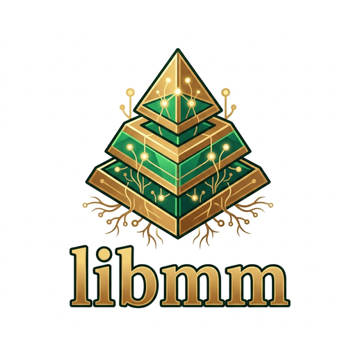

<p align="center">
  
</p>

# libmm

[](npm/README.md)
[](#)
[](#)
[](#)
[](#)

> Pure-C two-tier multi-axis memory engine, codebase symbol & call-graph indexer, and universal CLI/MCP substrate built on [`libcorm`](https://github.com/tty-pt/libcorm), [`liblemma`](https://github.com/tty-pt/liblemma), [`libsepal`](https://github.com/tty-pt/libsepal), [`libjoint`](https://github.com/tty-pt/libjoint), [`libislet`](https://github.com/tty-pt/libislet), and [`libstele`](https://github.com/tty-pt/libstele). Canonical header is `<ttypt/mm.h>` and pkg-config package `mm.pc`.

`libmm` provides the cognitive, epistemic, and codebase-indexing engine behind `pi-mm` as a standalone C library (`libmm.so`), universal native CLI (`mm`), zero-JS Model Context Protocol server (`mm mcp`), and universal Node.js/Browser package (`@tty-pt/mm`).

---

## 1. Quickstart

### C API (`<ttypt/mm.h>`)

```c
#include <stdio.h>
#include <stdlib.h>
#include <ttypt/mm.h>

int main(void) {
    /* 1. Open federated two-tier memory context (Global + Project) */
    mm_options_t opts = {
        .cwd = ".",
        .semantic_search = true,
        .prefer_daemon = true
    };
    mm_ctx_t *ctx = mm_open(&opts);

    /* 2. Record a standing operator rule or verified episode */
    mm_tier_t tier;
    uint32_t ref = 0;
    mm_record_req_t rec = {
        .tier = MM_TIER_AUTO,
        .level = MM_LEVEL_L2,
        .problem = "Always use reactive wakeup notifications instead of polling loops",
        .type = "rule",
        .status = MM_STATUS_SUPPORTED,
        .standing = true,
        .anchor = true
    };
    mm_record(ctx, &rec, &tier, &ref);

    /* 3. Recall across persistent lore, session transcripts, or codebase symbols */
    char *report = NULL;
    size_t len = 0;
    mm_recall_req_t q = {
        .scope = MM_SCOPE_PERSISTENT,
        .tier = MM_TIER_BOTH,
        .query = "polling loops",
        .limit = 5
    };
    if (mm_recall(ctx, &q, &report, &len) == 0 && report) {
        printf("%s\n", report);
        free(report);
    }

    mm_close(ctx);
    return 0;
}
```

Compile and link:
```sh
cc app.c $(pkg-config --cflags --libs mm) -o app
```

### Universal `mm` CLI & Zero-JS MCP Server

```sh
# Record a standing global rule (routes automatically to Tier 1 Global)
mm record --standing --anchor --problem "Never poll status in a loop; await reactive notifications"

# Record a project episode (routes to Tier 2 Project)
mm record --type episode --status supported --problem "Fixed offscreen FBO viewport resize"

# Recall across persistent lore, codebase AST symbols, or session logs
mm recall --scope persistent "reactive notifications"
mm recall --scope code --symbol mm_fuse_rankings_rrf --neighbors both
mm recall --scope code --trace mm_recall --direction outbound --depth 2
mm recall --scope code --diff

# Run the native JSON-RPC 2.0 MCP server over stdio (Claude Code, Cursor, Zed, Pi)
mm mcp
```

---

## 2. Two-Tier Federated Architecture & Three Recall Scopes

`libmm` unifies three memory scopes across two physical storage tiers:

### Two Storage Tiers (`mm_tier_t`)
1. **Tier 1 — Global (`MM_TIER_GLOBAL`, `~/.local/share/mm/global/mem.db`)**:
   - Operator-wide standing directives (`standing: true`), persona tenets, flashbulb anchors (`anchor: true`), and desktop/voice history (`dwm-jarvis`).
2. **Tier 2 — Project (`MM_TIER_PROJECT`, `<repo>/.mm/mem.db` or `~/.pi/agent/mm/<slug>`)**:
   - Repository-scoped architectural invariants, debugging episodes, verification-attested root causes, symbol-bound lore, codebase AST graph, and coding session transcripts.
3. **Automatic Routing (`MM_TIER_AUTO` / `MM_TIER_BOTH`)**:
   - Writes with `standing = true` route automatically to Tier 1 (`Global`); project episodes route to Tier 2 (`Project`).
   - Reads federate both tiers via Adaptive Reciprocal Rank Fusion (`mm_fuse_rankings_rrf`).

### Three Recall Scopes (`mm_scope_t`)
| Scope | Subsystem | Capabilities |
| :--- | :--- | :--- |
| **`MM_SCOPE_PERSISTENT`** | `src/libmm.c`, `src/mm_ctx.c`, `src/mm_fusion.c` | HTOK v4 binary envelope storage (`mm_payload_encode`/`decode`), `L0`–`L3` temporal mipmapping (`mm_window_for_level`), hybrid lexical (`liblemma`) + semantic (`libsepal`) RRF fusion (`mm_fuse_rankings_rrf`), 8-factor epistemic scoring (`mm_compute_ranking_score`), evidence DAG truth maintenance (`mm_propagate_truth_maintenance`), and sleep-cycle consolidation (`mm_consolidate_scopes_and_principles`). |
| **`MM_SCOPE_CODE`** | `src/mm_code.c` | Multi-language zero-regex structural scanner (`mm_code_scan_source`) for C/C++, TypeScript/JavaScript, Python, Go, and Rust; symbol search (`mm_code_search`); concrete symbol/batch source read (`mm_code_read_symbols_ex`); call-graph traversal (`mm_code_trace`); architecture overview (`mm_code_overview`); `git diff` blast-radius impact (`mm_code_diff_impact`); stack-trace fault localization (`mm_code_diagnose`); `XY_DECL`/`XY_IMPL` parity checks (`mm_code_detect_xy_mismatches`); cross-boundary pairing (`mm_code_resolve_cross_boundary_pairs`); first-touch module dossiers (`mm_code_first_touch_dossier`); code-to-lore binding (`mm_lore_bind_symbol`, `mm_lore_verify_drift`); and swarm stigmergy leases (`mm_swarm_record_lease`). |
| **`MM_SCOPE_SESSION`** | `src/mm_session.c` | Append-only session transcript ingestion (`mm_session_ingest_event`), branch-aware 3-tier session recall (`mm_session_recall_ex`), mipmap session compaction (`mm_session_compact`), pre-flight counterfactual guardrails (`mm_evaluate_guardrail`), verification-attested promotion (`mm_observe_verification_command`), and prompt intent priming (`mm_classify_prompt`, `mm_prime`). |

---

## 3. Public C API Overview (`<ttypt/mm.h>`)

| Category | Key Functions |
| :--- | :--- |
| **Context Lifecycle** | `mm_open()`, `mm_close()`, `mm_get_tier_dir()`, `mm_get_project_root()`, `mm_get_project_name()`, `mm_has_project_tier()`, `mm_next_ref()` |
| **Envelope & HTOK v4 Codec** | `mm_envelope_init()`, `mm_envelope_free()`, `mm_envelope_clone()`, `mm_envelope_to_json()`, `mm_envelope_from_json()`, `mm_payload_encode()`, `mm_payload_decode()`, `mm_window_for_level()` |
| **RRF & Epistemic Ranking** | `mm_adaptive_rrf_k()`, `mm_fuse_rankings_rrf()`, `mm_compute_ranking_score()`, `mm_filter_and_enrich()`, `mm_is_technical_inquiry()`, `mm_is_code_or_doc_artifact()`, `mm_is_question_memory()`, `mm_is_assistant_echo()`, `mm_is_clean_summary_text()` |
| **Record, Recall & Review** | `mm_record()`, `mm_recall()`, `mm_recall_candidates()`, `mm_review()`, `mm_review_ex()`, `mm_get_envelope()`, `mm_put_envelope()`, `mm_forget()`, `mm_list_refs()`, `mm_traverse()`, `mm_build_memory_overview()` |
| **Truth Maintenance & Guardrails** | `mm_validate_lifecycle_transition()`, `mm_propagate_truth_maintenance()`, `mm_evaluate_guardrail()`, `mm_observe_verification_command()`, `mm_record_file_mutation()`, `mm_consolidate_scopes_and_principles()` |
| **Codebase AST & Call Graph** | `mm_code_index_init()`, `mm_code_scan_source()`, `mm_code_index_dir()`, `mm_code_resolve_call_graph()`, `mm_code_search()`, `mm_code_read_symbol()`, `mm_code_read_symbols_ex()`, `mm_code_trace()`, `mm_code_overview()`, `mm_code_diff_impact()`, `mm_code_diagnose()`, `mm_code_detect_xy_mismatches()`, `mm_code_resolve_cross_boundary_pairs()`, `mm_code_first_touch_dossier()` |
| **Session & MCP Server** | `mm_session_ingest_turn()`, `mm_session_ingest_event()`, `mm_session_recall_ex()`, `mm_session_compact()`, `mm_classify_prompt()`, `mm_prime()`, `mm_consolidate_drain()`, `mm_mcp_serve_stdio()` |
| **Multi-Project & Federation** | `mm_project_register()`, `mm_project_resolve()`, `mm_project_list()`, `mm_project_open_index()`, `mm_project_code_search()`, `mm_project_code_symbol()`, `mm_project_code_trace()`, `mm_project_recall_all()` |
| **Zero-JSON Distillation** | `mm_distill_prompt()`, `mm_distill_parse()`, `mm_distill_commit()` |
| **Operational Metrics** | `mm_get_metrics()`, `mm_reset_metrics()`, `mm_format_metrics()` |

👉 *See [docs/ARCHITECTURE.md](docs/ARCHITECTURE.md) and [docs/API.md](docs/API.md) for detailed architecture and C API guides.*

---

## 4. Installation & Build

### Prebuilt Packages
Prebuilt packages for Linux (APT / Alpine / Arch / Fedora-RHEL), macOS (Homebrew), Windows (winget / MSYS2), and OpenBSD are distributed via [**tty.pt packages**](https://github.com/tty-pt/ci/blob/main/docs/install.md). Use **libmm** as the package name.

### Build from Source
```sh
make                  # builds lib/libmm.so, bin/mm, and mods/ren-mm/ren-mm.so
make test             # runs all C unit suites (payload, fusion, code, project, distill, federation, metrics, ren-mm, CLI/MCP)
make docs             # generates Doxygen manpages (man/mm.h.3)
make wasm             # builds npm/dist/mm.wasm via centralized toolchain
make npm-build        # builds Node-API addon (npm/dist/mm_node.node)
make npm-test         # runs Node.js N-API and WASM test suite
make PREFIX="$HOME/.local" install
```

---

## 5. JavaScript & WebAssembly Bindings (`@tty-pt/mm`)

Official Node.js and Browser WebAssembly bindings are colocated in [`npm/`](npm/README.md):
- **Universal Runtime**: Native Node-API prebuilds across 6 target platforms (`linux-x64`, `linux-arm64`, `linux-x64-musl`, `darwin-arm64`, `darwin-x64`, `win32-x64`) with seamless fallback to the precompiled WebAssembly reactor (`dist/mm.wasm`) on `@tty-pt/stele`.
- **Two-Tier Memory & Codebase Intelligence**: `MmContext`, `MmCodeIndex`, HTOK v4 binary codecs, hybrid RRF ranking, and structural multi-language symbol scanning.
- **C Development Headers**: Install via `npm install @tty-pt/mm` and consume canonical headers from `node_modules/@tty-pt/mm/include`.

👉 *For complete TypeScript usage, browser WASM guides, and API reference, see [npm/README.md](npm/README.md).*

---

## 6. Multi-Project Federation, Zero-JSON Distillation, Telemetry & `ren-mm`

- **Multi-Project Registry & Federation (`src/mm_project.c`)**:
  - `mm_project_resolve(name_or_path, &info)`: Resolves registered projects from `~/.local/share/mm/projects.tsv`, explicit directories, or lazily probes `MM_PROJECT_ROOTS` (default: `$HOME:$HOME/site/external`).
  - `mm_project_open_index(&proj, &idx)`: Loads cached manifests and automatically re-indexes when source file `mtime`s are newer than the manifest.
  - `mm_project_code_search` / `mm_project_code_symbol` / `mm_project_code_trace`: Query a specific project or pass `NULL` to search across all registered projects, prefixing results with `[project]`.
  - `mm_project_recall_all(query, limit, &out, &len)`: Federates persistent memory recall across all registered projects and the global tier via RRF.
- **Zero-JSON Distillation (`src/mm_distill.c`)**:
  - `mm_distill_prompt()`, `mm_distill_parse()`, `mm_distill_commit()`: Pure-C line-delimited key-value distillation (`PROBLEM:`, `TYPE:`, `APPROACH:`, `FINDING:`, `CONSTRAINT:`) with zero JSON parsing overhead.
- **Operational Metrics & Telemetry (`src/mm_ctx.c`, `src/mm.c`)**:
  - `mm_get_metrics()` / `mm_format_metrics()` and `mm metrics [--json]` expose latency, cache hit, transport (`inmem`, `cormd`, `cli`), HTOK token decode, filtering, and footprint counters, alongside multi-process IPC invalidation and telemetry journaling.
- **`ren-mm` Adapter (`mods/ren-mm/ren-mm.c`)**:
  - Xylem adapter module integrating `libmm` (`MM_TIER_BOTH`, JSON schema, and structured `recall` / `record` tool arguments) into `libren`.

## License

BSD 2-Clause License — Copyright (c) 2026, Paulo André Azevedo Quirino. See [`LICENSE`](LICENSE).