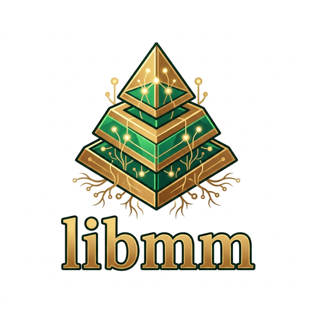

<p align="center">
  
</p>

# @tty-pt/mm

[](https://www.npmjs.com/package/@tty-pt/mm)
[](#)
[](#)
[](#)
[](#)
[](#)

> Universal Node.js and Browser bindings for **`libmm`** — the Pure-C Two-Tier Multi-Axis Memory Engine, Codebase Symbol/Call-Graph Indexer, and Universal CLI/MCP Substrate built on `@tty-pt/corm`, `@tty-pt/lemma`, `@tty-pt/sepal`, `@tty-pt/joint`, `@tty-pt/islet`, and `@tty-pt/stele`. Canonical C header: `<ttypt/mm.h>`.

📖 **Full C & CLI/MCP Documentation**: See the main [**libmm GitHub README**](https://github.com/tty-pt/libmm#readme) for the two-tier architecture, `mm` CLI commands, `mm mcp` JSON-RPC 2.0 server, and C API reference.

---

## 1. Quickstart & Installation

```bash
npm install @tty-pt/mm
```

**Native OS Packages (`tty.pt`)**: Prebuilt native C packages (`libmm`) for Linux (`apt`, `apk`, `pacman`, `dnf`), macOS (`brew`), Windows (`winget`, MSYS2), and OpenBSD (`pkg_add`) are available via the [**tty.pt package repositories**](https://github.com/tty-pt/ci/blob/main/docs/install.md).

```typescript
import {
  MmContext,
  MmCodeIndex,
  fuseRankingsRRF,
  computeRankingScore,
  payloadEncode,
  payloadDecode,
  scanSource,
  wasmRecord,
  wasmRecallJson,
} from "@tty-pt/mm";

// 1. Open federated two-tier memory context (native N-API or WASM reactor fallback)
const ctx = new MmContext({ cwd: process.cwd() });
const rec = ctx.record({
  problem: "Always use reactive wakeup notifications instead of polling loops",
  standing: true,
  anchor: true,
  tags: "workflow,concurrency",
});

console.log(ctx.recall({ scope: "persistent", query: "polling loops" }));
ctx.close();

// 2. Scan source code or query repository call graph in-process
const symbols = scanSource("src/example.c", "int add(int a, int b) { return a + b; }");
console.log("Scanned symbols:", symbols);

// 3. Direct WebAssembly reactor usage (browser / edge / sandboxed runtimes)
wasmRecord("Browser WASM memory entry", "Verified", "ui", true);
console.log(JSON.parse(wasmRecallJson("WASM memory", "ui", 5)));
```

---

## 2. Dual-Engine Runtime: Native Speed & Browser Portability

`@tty-pt/mm` operates on a dual-engine runtime:
1. **Node.js Native (N-API)**: Ships prebuilt `mm.node` addons across all 6 target platforms (`linux-x64`, `linux-arm64`, `linux-x64-musl`, `darwin-arm64`, `darwin-x64`, `win32-x64`) with full two-tier `libcorm` persistence, daemon IPC (`cormd`), and structural codebase indexing (`MmCodeIndex`).
2. **Browser & Edge WebAssembly (`dist/mm.wasm`)**: In browsers, Cloudflare Workers, or platforms without a native addon, `@tty-pt/mm` imports zero `node:*` built-ins at top level and falls back seamlessly to `dist/mm.wasm` hosted on `@tty-pt/stele`'s shared linear memory substrate.

---

## 3. Features

- **Two-Tier Federated Memory (`MmContext`)**:
  - **Tier 1 (`Global`)**: Persistent user-wide rules, standing restrictions, persona tenets, and cross-project operator facts (`~/.local/share/mm/global/mem.db`).
  - **Tier 2 (`Project`)**: Repository-scoped architectural lore, bug post-mortems, verification-attested root causes, and symbol-linked memory (`<repo>/.mm/mem.db`).
- **HTOK v4 Binary Envelope Codec (`payloadEncode`, `payloadDecode`)**: Zero-overhead binary serialization with legacy `MM_META` and raw-text fallback.
- **Hybrid RRF & Multi-Factor Ranking (`fuseRankingsRRF`, `computeRankingScore`, `filterAndEnrich`, `adaptiveRrfK`)**: Adaptive Reciprocal Rank Fusion, epistemic status multipliers, temporal decay, and hygiene gates (`isTechnicalInquiry`, `isCodeOrDocArtifact`, `isQuestionMemory`, `isAssistantEcho`, `isCleanSummaryText`).
- **Codebase Symbol & Call-Graph Indexer (`MmCodeIndex`, `scanSource`)**: Multi-language structural symbol scanner (C/C++, TypeScript/JavaScript, Python, Go, Rust), call-graph tracer, git diff blast-radius analyzer, stack-trace fault localizer, `XY_DECL`/`XY_IMPL` contract checker, and cross-boundary resolver.

---

## 4. API Reference

### `MmContext`
- `new MmContext(opts?: MmContextOptions)`
- `.info()`: Returns `{ projectRoot, projectName, hasProjectTier, globalDir, projectDir }`.
- `.record(req: MmRecordRequest)`: Records a note, rule, decision, or episode into Tier 1 (`Global`) or Tier 2 (`Project`).
- `.recall(req: MmRecallRequest)`: Executes multi-resolution recall across `persistent`, `code`, `session`, or `all` scopes.
- `.review(req: MmReviewRequest)`: Inspects evidence hierarchy or transitions epistemic lifecycle state (`confirm`, `contradict`, `supersede`, `reclassify`, `promote`, `forget`).
- `.overview(tier?: MmTier, maxPerBucket?: number)`: Synthesizes an `L3`/`L2`/`L1` memory overview.
- `.evaluateGuardrail(intentText: string, filePath?: string, symbolName?: string)`: Pre-flights a planned edit or command against contradicted memories and standing restrictions.
- `.observeVerification(command: string, exitCode: number, outputSnippet?: string)` / `.recordFileMutation(filePath: string)`: Verification-attested promotion ledger hooks.
- `.prime(prompt: string)` / `.consolidate(tier?: MmTier)` / `.close()`.

### `MmCodeIndex` & `scanSource`
- `new MmCodeIndex(rootDir?: string)`
- `.search(query?, fileFilter?, kindFilter?, limit?)`
- `.readSymbols(symbols, opts?)`
- `.trace(symbolName, direction?, depth?)`
- `.overview()` / `.diffImpact(depth?)` / `.diagnose(traceText, depth?)`
- `.detectXyMismatches()` / `.resolveCrossBoundary(symbolName?, filePath?)` / `.firstTouchDossier(fileOrSymbol)`
- `scanSource(filePath: string, content: string, fileId?: number): MmCodeSymbol[]`

### Native Addon Multi-Project, Distillation & Session Exports (`nativeBinding`)
When the native N-API addon is loaded, `nativeBinding` also exposes direct bindings for:
- `projectCodeSearch`, `projectCodeSymbol`, `projectCodeTrace`
- `distillPrompt`, `distillCommit`
- `sessionIngestTurn`, `sessionRecall`, `traverse`

### WebAssembly Reactor (`dist/mm.wasm`)
- `getMmWasm(): WebAssembly.Instance`
- `wasmRecord(problem: string, outcome?: string, subsystem?: string, standing?: boolean): number`
- `wasmRecallJson(query?: string, subsystem?: string, limit?: number): string`
- `wasmReview(ref: number, action: MmReviewAction | string, reason?: string): number`

### Stateless Fusion, Ranking & Envelope Helpers
- `adaptiveRrfK(candidateCount: number): number`
- `fuseRankingsRRF(lexical, semantic, kOverride?): MmRankedRef[]`
- `computeRankingScore(cand: MmCandidate, crit?: MmFilterCriteria): number`
- `filterAndEnrich(candidates: MmCandidate[], crit?: MmFilterCriteria): MmCandidate[]`
- `payloadEncode(envelopeOrJson: MmEnvelope | string): { bytes: Uint8Array; json: string }`
- `payloadDecode(bytesOrStr: Uint8Array | string): MmEnvelope`
- `windowForLevel(level: MmLevel | string, nowEpochSec?: number): { bounded: boolean; since: string; until: string }`
- `classifyPrompt(prompt: string): MmPromptProfile`
- `isTechnicalInquiry(query: string): boolean`
- `isCleanSummaryText(summary: string): boolean`
- `isCodeOrDocArtifact(record: string, envelope?: MmEnvelope | string): boolean`
- `isQuestionMemory(envelope?: MmEnvelope | string): boolean`
- `isAssistantEcho(envelope?: MmEnvelope | string): boolean`

---

## 5. C Development Headers via NPM

This package includes the canonical C development headers in `include/` and `mm.pc`:
```makefile
CFLAGS += -I./node_modules/@tty-pt/mm/include
LDLIBS += -lmm
```

---

## 6. Building from Source

```bash
make npm-build    # Compiles native addon (build/Release/, dist/)
make wasm         # Compiles WebAssembly reactor (dist/mm.wasm)
make npm-test     # Runs Node.js N-API and WASM test suite
```

## License

BSD-2-Clause — Copyright (c) 2026, Paulo André Azevedo Quirino. See [LICENSE](https://github.com/tty-pt/libmm/blob/main/LICENSE).